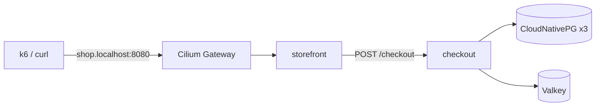
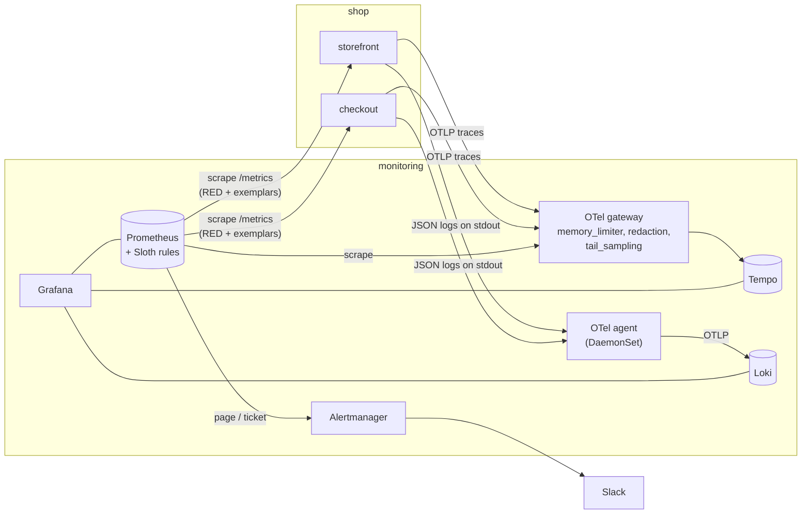

# Architecture

Everything runs on one kind cluster on a laptop (ADR 0001), deployed by Argo CD
from this repo (ADR 0002). This page covers the request path and the telemetry
built on it in Stage 2; the decisions behind each part are in `docs/adr/`.

## Request path

`checkout` has two fault flags, `ERROR_RATE` and `LATENCY_MS`. They are changed
by committing to `gitops/shop/checkout.yaml`, because Argo CD reverts
`kubectl set env` (ADR 0003).

## Telemetry

| Signal | Path | ADR |
|---|---|---|
| Metrics | `metrics.Wrap` exposes RED metrics on `:9090`; a PodMonitor scrapes them, plus CNPG and the gateway collector's own metrics | 0004, 0008 |
| Traces | OTel SDK → gateway collector (hashes `user.email`, keeps errors, slow and 10% of the rest) → Tempo | 0005, 0008 |
| Logs | `slog` JSON access logs with `trace_id` → agent tails `/var/log/pods` → Loki | 0006 |
| SLOs | `slos/checkout.yaml` → `make slo` → committed PrometheusRule → Alertmanager → Slack | 0007, 0008 |
| Dashboards | ConfigMaps in `gitops/monitoring/dashboards/`, loaded by Grafana's sidecar | 0008 |

Grafana links the three signals: an exemplar dot on a latency panel opens its
trace, a trace opens the logs with the same `trace_id`, and a log line opens
its trace.

## What a burn looks like

ADR 0009 records two real burns on checkout (5% errors, then 400 ms latency),
with screenshots in [`docs/evidence/`](docs/evidence/).
