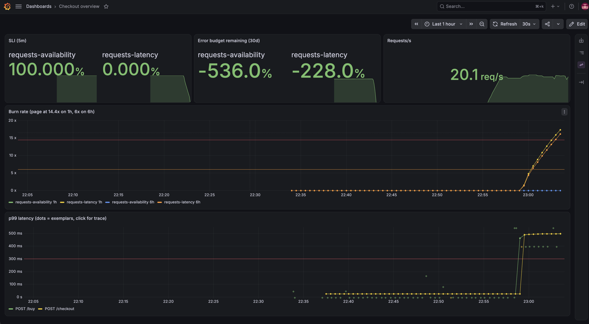

# SRE Reference Platform

A local-first Kubernetes platform built to show how SLOs, progressive delivery,
chaos experiments, and cost guardrails work together — with the postmortems and
GameDay reports from what actually broke along the way.

Work in progress. Progress is tracked in [milestones](https://github.com/alexboscolo954/sre-reference-platform/milestones).

How it fits together: [ARCHITECTURE.md](ARCHITECTURE.md). Every decision is an
ADR in [docs/adr/](docs/adr/).

## Evidence: SLO burns on checkout

Two real error-budget burns, injected through git and paged to Slack
([ADR 0009](docs/adr/0009-burn-proof.md)).

| | 5% errors | 400 ms latency |
|---|---|---|
| Dashboard | [checkout overview](docs/evidence/availability-checkout-overview.png) | [checkout overview](docs/evidence/latency-checkout-overview.png) |
| SLO detail | [Sloth](docs/evidence/availability-slo-detail.png) | [Sloth](docs/evidence/latency-slo-detail.png) |
| Alerts | [firing rules](docs/evidence/availability-alert-rules.png) | [firing rules](docs/evidence/latency-alert-rules.png) |
| Trace | [500 through checkout](docs/evidence/availability-error-trace.png) | [401 ms request](docs/evidence/latency-slow-trace.png) |
| Slack | [firing](docs/evidence/availability-slack-firing.png), [resolved](docs/evidence/availability-slack-resolved.png) | [firing](docs/evidence/latency-slack-firing.png), [resolved](docs/evidence/latency-slack-resolved.png) |

License: [MIT](LICENSE)
